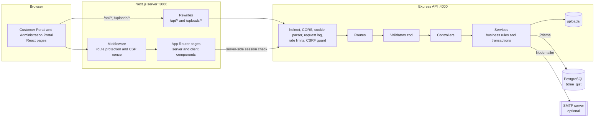
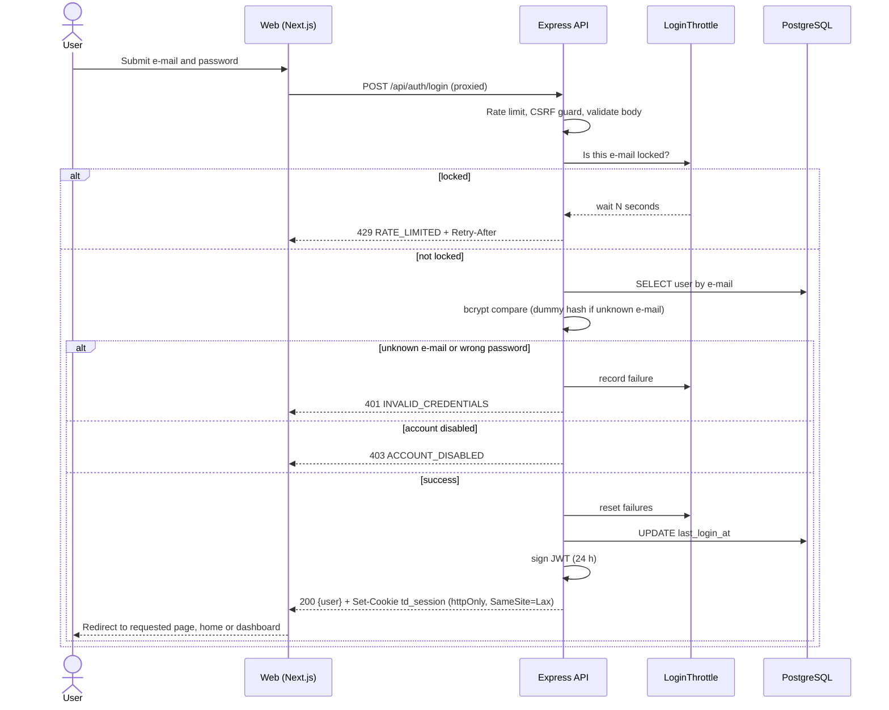
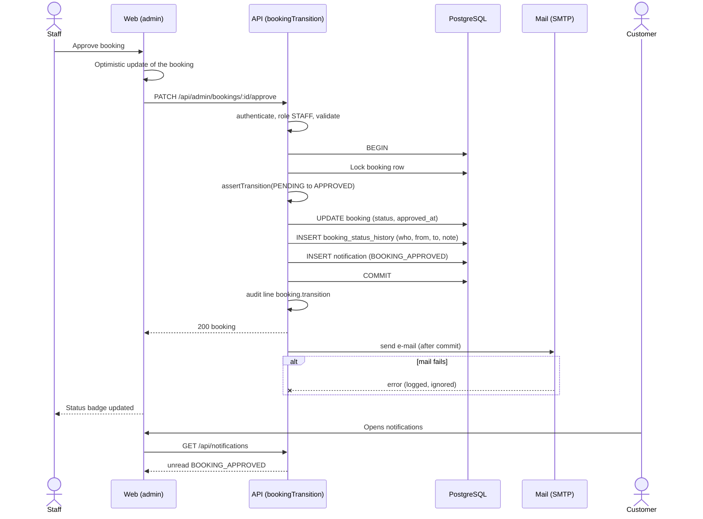
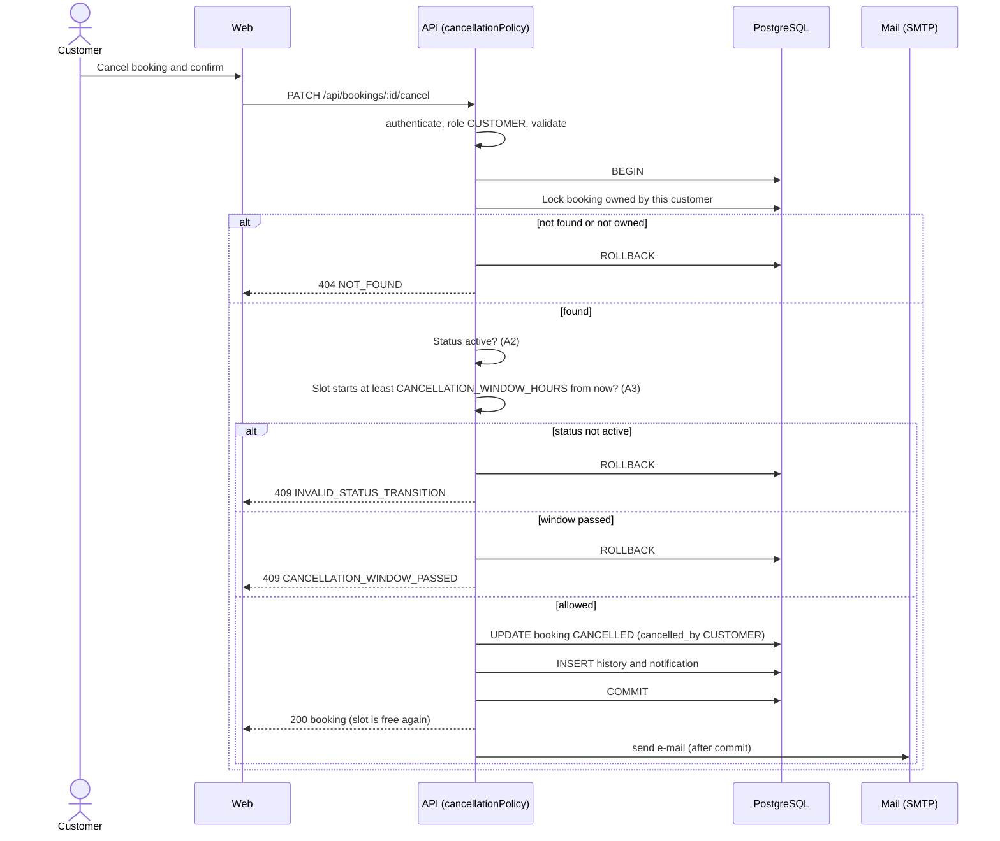
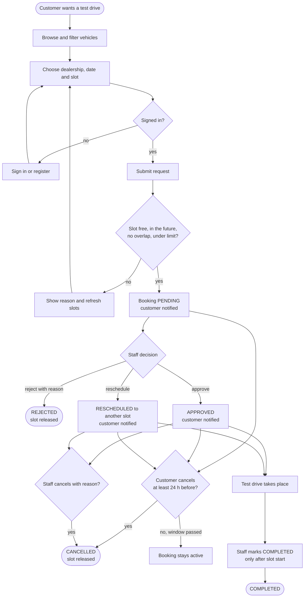
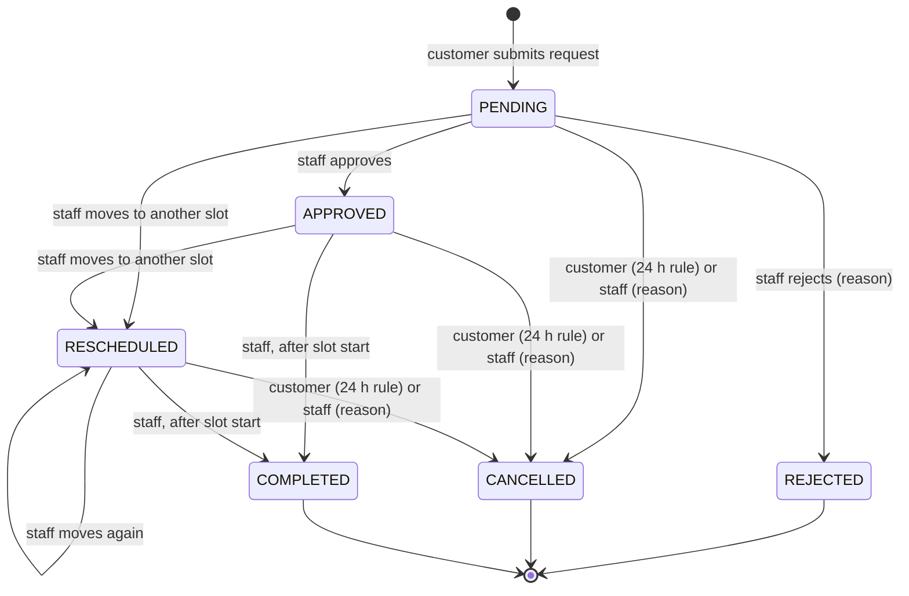

# System design

Architecture, data design, module overview and behaviour diagrams for the Luxury Car Test-Drive Booking and Management System. All diagrams are Mermaid and render on GitHub and in VS Code with a Mermaid preview extension.

## 1. Architecture

### 1.1 Overview



The browser only talks to the web origin. Next.js forwards `/api/*` and `/uploads/*` to Express (`API_URL`), so the `td_session` cookie is same-origin (A11). Pages that need the signed-in user call the API from the server with the incoming cookie.

### 1.2 Layers

| Layer | Folder | Responsibility | Must not |
| --- | --- | --- | --- |
| Route | `api/src/routes` | Maps a URL and method to middleware, a validator and a controller; declares who may call it (`authenticate`, `requireRole`). | Contain logic. |
| Validator | `api/src/validators` | Strict zod schemas for body, query and path; coerces types; rejects unknown fields. | Touch the database. |
| Controller | `api/src/controllers` | Reads validated input, calls one service function, sends the response envelope. | Hold business rules. |
| Service | `api/src/services` | Business rules, state machine, transactions, locks, notifications. | Know about HTTP. |
| Data access | Prisma client, `api/src/config/prisma.ts` | Typed queries; a few tagged raw queries for `FOR NO KEY UPDATE` locks, text search and aggregates. | Build SQL from strings. |
| Middleware | `api/src/middleware` | Authentication, validation, rate limits, lockout, CSRF guard, uploads, request log, error handler. | Contain business rules. |
| Utilities | `api/src/utils` | Response envelope, `AppError`, token and cookie helpers, DTO mappers, locks, pagination. | Depend on services. |

Web layers: **pages** (`web/src/app`), **feature components** (`web/src/components`), **shared UI kit** (`web/src/components/ui`), **hooks** (`web/src/hooks`) and **library code** (`web/src/lib`: API client, zod schemas shared by forms, formatting, route access rules, query keys).

### 1.3 Cross-cutting behaviour

| Concern | How it works |
| --- | --- |
| Response envelope | `sendSuccess` / `sendError` in `api/src/utils/response.ts`; the error handler converts `AppError`, zod and Prisma errors to the standard failure envelope. |
| Authentication | `authenticate` verifies the JWT cookie, loads the user row on every request (so deactivation takes effect immediately) and sets `req.user`. `requireRole` checks CUSTOMER or STAFF. |
| Validation | `validate({ body, query, params })` runs the schemas and stores parsed values; failures become 422 `VALIDATION_ERROR` with `details`. |
| Concurrency | Transactions with `FOR NO KEY UPDATE` row locks (`utils/locks.ts`) and the database constraints in section 3.3. |
| Notifications | `notify` writes the in-app row inside the booking transaction; `deliverEmails` sends mail after commit and swallows failures. |
| Logging and audit | JSON request log without query strings, headers or bodies; `staff.write` and `booking.transition` audit lines. |
| Web data fetching | React Query with a central key factory; optimistic updates with rollback for cancel and staff actions; server validation errors mapped onto form fields. |

## 2. Entity-relationship diagram

The diagram and its notes are in [er-diagram.md](er-diagram.md). Nine tables: `users`, `dealerships`, `vehicles`, `vehicle_images`, `dealership_vehicles`, `time_slots`, `bookings`, `booking_status_history`, `notifications`.

## 3. Data dictionary

Naming: tables and columns are `snake_case` (Prisma `@map`); identifiers are UUIDs generated by the application; timestamps are `timestamptz` stored in UTC. "PK" primary key, "FK" foreign key, "UQ" unique.

### 3.1 Enumerations

| Enum | Values |
| --- | --- |
| `Role` | `CUSTOMER`, `STAFF` |
| `VehicleType` | `SEDAN`, `SUV`, `COUPE`, `CONVERTIBLE`, `HATCHBACK`, `SPORTS`, `GRAND_TOURER`, `MPV` |
| `FuelType` | `PETROL`, `DIESEL`, `HYBRID`, `PLUG_IN_HYBRID`, `ELECTRIC` |
| `Transmission` | `AUTOMATIC`, `MANUAL`, `DUAL_CLUTCH` |
| `BookingStatus` | `PENDING`, `APPROVED`, `REJECTED`, `CANCELLED`, `COMPLETED`, `RESCHEDULED` |
| `NotificationType` | `BOOKING_CREATED`, `BOOKING_APPROVED`, `BOOKING_REJECTED`, `BOOKING_RESCHEDULED`, `BOOKING_CANCELLED`, `BOOKING_COMPLETED` |

### 3.2 Tables

#### `users`

Customers and staff (A1).

| Column | Type | Null | Default | Description |
| --- | --- | --- | --- | --- |
| `id` | uuid | no | generated | PK |
| `email` | text | no | | UQ; stored lower case |
| `password_hash` | text | no | | bcrypt hash (cost 12); never returned by the API |
| `role` | `Role` | no | `CUSTOMER` | Authorisation role |
| `first_name` | text | no | | |
| `last_name` | text | no | | |
| `phone` | text | no | | |
| `driving_license_number` | text | yes | | Optional customer licence number |
| `is_active` | boolean | no | `true` | `false` blocks sign-in and all requests |
| `last_login_at` | timestamptz | yes | | Set on each successful sign-in |
| `created_at` | timestamptz | no | now | |
| `updated_at` | timestamptz | no | auto | |

#### `dealerships`

| Column | Type | Null | Default | Description |
| --- | --- | --- | --- | --- |
| `id` | uuid | no | generated | PK |
| `name` | text | no | | Unique together with `city` (`dealerships_name_city_unique`) |
| `address` | text | no | | |
| `city` | text | no | | |
| `phone` | text | no | | |
| `email` | text | no | | |
| `opening_hours` | text | no | | Free text shown to customers |
| `description` | text | yes | | |
| `is_active` | boolean | no | `true` | Soft delete (A6) |
| `created_at`, `updated_at` | timestamptz | no | now / auto | |

#### `vehicles`

| Column | Type | Null | Default | Description |
| --- | --- | --- | --- | --- |
| `id` | uuid | no | generated | PK |
| `manufacturer` | text | no | | Indexed with `model` |
| `model` | text | no | | |
| `year` | integer | no | | Model year |
| `vehicle_type` | `VehicleType` | no | | Indexed |
| `fuel_type` | `FuelType` | no | | Indexed |
| `transmission` | `Transmission` | no | | |
| `engine` | text | no | | Engine description |
| `power_hp` | integer | no | | |
| `top_speed_kmh` | integer | yes | | |
| `acceleration_0_to_100` | numeric(4,2) | yes | | Seconds |
| `seats` | integer | no | | |
| `color` | text | no | | |
| `price_from` | numeric(12,2) | yes | | Indicative starting price |
| `description` | text | no | | |
| `features` | text[] | no | | List of feature names |
| `availability_note` | text | yes | | Availability information shown to customers |
| `is_active` | boolean | no | `true` | Soft delete; indexed |
| `created_at`, `updated_at` | timestamptz | no | now / auto | |

#### `vehicle_images`

| Column | Type | Null | Default | Description |
| --- | --- | --- | --- | --- |
| `id` | uuid | no | generated | PK |
| `vehicle_id` | uuid | no | | FK to `vehicles`, cascade delete; indexed |
| `url` | text | no | | Path under `/uploads` (or a seeded asset path) |
| `alt_text` | text | no | | Accessible description |
| `is_primary` | boolean | no | `false` | At most one primary per vehicle (partial unique index `one_primary_image_per_vehicle`) |
| `sort_order` | integer | no | `0` | Display order |
| `created_at`, `updated_at` | timestamptz | no | now / auto | |

#### `dealership_vehicles`

Which vehicles a dealership offers (availability information, FR-3).

| Column | Type | Null | Default | Description |
| --- | --- | --- | --- | --- |
| `dealership_id` | uuid | no | | PK part 1; FK to `dealerships`, cascade delete |
| `vehicle_id` | uuid | no | | PK part 2; FK to `vehicles`, cascade delete |
| `is_available` | boolean | no | `true` | Whether the dealership currently offers the vehicle |
| `created_at`, `updated_at` | timestamptz | no | now / auto | |

#### `time_slots`

| Column | Type | Null | Default | Description |
| --- | --- | --- | --- | --- |
| `id` | uuid | no | generated | PK |
| `dealership_id` | uuid | no | | FK to `dealerships`; with `vehicle_id` a composite FK to `dealership_vehicles` |
| `vehicle_id` | uuid | no | | FK to `vehicles`; indexed with `start_at` |
| `start_at` | timestamptz | no | | Indexed |
| `end_at` | timestamptz | no | | Check: greater than `start_at` |
| `is_active` | boolean | no | `true` | Soft delete (A6) |
| `created_by_id` | uuid | no | | FK to `users` (the staff member who created it) |
| `created_at`, `updated_at` | timestamptz | no | now / auto | |

#### `bookings`

| Column | Type | Null | Default | Description |
| --- | --- | --- | --- | --- |
| `id` | uuid | no | generated | PK; the customer-facing reference is derived from it |
| `customer_id` | uuid | no | | FK to `users`; indexed with `status` |
| `slot_id` | uuid | no | | FK to `time_slots`; changes on reschedule |
| `status` | `BookingStatus` | no | `PENDING` | Current status (A2) |
| `customer_note` | text | yes | | Note from the customer |
| `staff_note` | text | yes | | Latest staff note |
| `rejection_reason` | text | yes | | Required when rejected |
| `cancellation_reason` | text | yes | | Required for staff cancellation |
| `cancelled_by` | `Role` | yes | | Who cancelled |
| `approved_at` | timestamptz | yes | | |
| `completed_at` | timestamptz | yes | | |
| `created_at`, `updated_at` | timestamptz | no | now / auto | Indexed (`status, created_at`) |

#### `booking_status_history`

| Column | Type | Null | Default | Description |
| --- | --- | --- | --- | --- |
| `id` | uuid | no | generated | PK |
| `booking_id` | uuid | no | | FK to `bookings`, cascade delete |
| `from_status` | `BookingStatus` | yes | | Null for the creation row |
| `to_status` | `BookingStatus` | no | | Indexed with `created_at` |
| `action` | text | no | | `CREATED`, `APPROVED`, `REJECTED`, `RESCHEDULED`, `CANCELLED`, `COMPLETED` |
| `note` | text | yes | | Reason or note |
| `old_slot_id` | uuid | yes | | Previous slot, set on reschedule |
| `new_slot_id` | uuid | yes | | New slot, set on reschedule |
| `changed_by_id` | uuid | no | | FK to `users` (who) |
| `created_at` | timestamptz | no | now | When |

#### `notifications`

| Column | Type | Null | Default | Description |
| --- | --- | --- | --- | --- |
| `id` | uuid | no | generated | PK |
| `user_id` | uuid | no | | FK to `users`, cascade delete; indexed with `is_read, created_at` |
| `booking_id` | uuid | yes | | FK to `bookings`, set null on delete |
| `type` | `NotificationType` | no | | |
| `title` | text | no | | |
| `message` | text | no | | |
| `is_read` | boolean | no | `false` | |
| `created_at` | timestamptz | no | now | |

### 3.3 Database safeguards

| Safeguard | Definition | Protects |
| --- | --- | --- |
| `one_active_booking_per_slot` | Partial unique index on `bookings(slot_id)` where status is PENDING, APPROVED or RESCHEDULED | A5: at most one active booking per slot, even if application code is bypassed |
| `time_slots_no_vehicle_overlap` | Exclusion constraint `EXCLUDE USING gist (vehicle_id WITH =, tstzrange(start_at, end_at) WITH &&) WHERE is_active` (needs `btree_gist`) | A4: slots of one vehicle never overlap |
| `time_slots_end_after_start` | Check `end_at > start_at` | A4 |
| `one_primary_image_per_vehicle` | Partial unique index on `vehicle_images(vehicle_id)` where `is_primary` | One primary image |
| `dealerships_name_city_unique` | Unique `(name, city)` | No duplicate dealerships |
| Composite FK `time_slots` to `dealership_vehicles` | A slot can only exist where the vehicle is offered | Data consistency |
| Indexes | Customer and status, status and created time, slot start times, vehicle filters, notification inbox | Query speed |

## 4. Module overview

### 4.1 API services

| Module | Responsibility |
| --- | --- |
| `auth.service` | Register, login (timing-safe, lockout aware), current user, logout support |
| `profile.service` | View and update own profile, change password |
| `catalog.service` | Customer catalogue: search, filters, vehicle detail |
| `slotAvailability.service`, `slotPreview.service` | Available slots for a vehicle; preview of one slot for the booking page |
| `booking.service` | Create booking (locks, checks, insert, notification) |
| `bookingRules` | Pure rule checks: slot bookable, free, overlap, limit |
| `bookingStateMachine` | Allowed transitions (A2): `canTransition`, `assertTransition` |
| `cancellationPolicy` | Eligibility for customer cancellation (A3) |
| `bookingTransition`, `bookingAction.service` | One path for every status change: lock, validate, update, history, notification, then e-mail |
| `myBooking.service`, `bookingHistory.service` | Customer views (A9), counts, timeline |
| `adminBooking.service` | Staff list, filters, detail |
| `dashboard.service` | Summary cards, trend, top vehicles |
| `vehicle.service`, `vehicleImage.service`, `vehicleAvailability.service` | Vehicle CRUD, images, dealership availability |
| `dealership.service` | Dealership CRUD and (de)activation |
| `slot.service`, `slotBulk.service`, `slotRules` | Slot CRUD, bulk generation with dry run, overlap and booking checks |
| `customer.service`, `staff.service` | Staff-side customer lookup; staff accounts |
| `notificationService`, `notificationTemplates`, `mailService`, `notificationInbox.service` | Notification rows, e-mail templates and delivery, customer inbox |
| `health.service` | Service and database health |

### 4.2 Web modules

| Area | Contents |
| --- | --- |
| `app/(site)` | Landing, `/vehicles`, `/vehicles/[id]`, `/login`, `/register`; protected `(member)` group: `/account`, `/book`, `/my-bookings`, `/my-bookings/[id]`, `/notifications` |
| `app/admin` | `/admin/login` and the shell group: dashboard, bookings, vehicles, dealerships, slots (single and bulk), customers, staff, profile |
| `components/ui` | Buttons, inputs, modal, drawer, toast, table, pagination, tabs, badges, skeletons, empty and error states |
| `components/*` | Feature components: booking flow, my bookings, catalogue, admin forms and tables, layout |
| `hooks` | `useApiForm`, `useBookingAction`, `useCancelBooking`, `useUrlFilters`, `useUnreadCount`, `useUnsavedChangesGuard` |
| `lib` | `api` client and `ApiError`, form schemas, `routeAccess`, `session`, `queryKeys`, formatting and calendar helpers |
| `middleware.ts` | Redirects visitors from protected paths to login, keeps signed-in users away from guest pages, sets the CSP nonce |

## 5. Sequence diagrams

### 5.1 Login



### 5.2 Create booking with conflict check

```mermaid
sequenceDiagram
  actor C as Customer
  participant W as Web
  participant A as API (booking.service)
  participant D as PostgreSQL
  participant M as Mail (SMTP)

  C->>W: Confirm slot and notes
  W->>A: POST /api/bookings {slotId, note}
  A->>A: authenticate, role CUSTOMER, validate body
  A->>D: BEGIN
  A->>D: Lock customer row (FOR NO KEY UPDATE)
  A->>D: Load slot with vehicle, dealership and offer (locked)
  A->>A: Slot active, offered, in the future?
  A->>D: Any active booking on this slot?
  A->>D: Customer has overlapping active booking?
  A->>D: Customer active bookings < MAX_ACTIVE_BOOKINGS?
  alt a rule fails
    A->>D: ROLLBACK
    A-->>W: 409 SLOT_UNAVAILABLE, BOOKING_CONFLICT, ACTIVE_BOOKING_LIMIT or 422 SLOT_IN_PAST
  else all rules pass
    A->>D: INSERT booking (PENDING)
    Note over D: Partial unique index one_active_booking_per_slot<br/>is the final guard against a race
    A->>D: INSERT history (CREATED) and notification
    A->>D: COMMIT
    A-->>W: 201 booking
    A->>M: send e-mail (after commit; failure ignored)
    W-->>C: Confirmation with reference
  end
```

If two customers race for the same slot, the second insert violates the partial unique index (or waits on the lock and then finds the slot taken); the API translates it into 409 `SLOT_UNAVAILABLE`, so exactly one request succeeds.

### 5.3 Staff approval with notification



If the request fails, the web app rolls the optimistic update back and shows the error (for example 409 `INVALID_STATUS_TRANSITION` when another staff member already decided).

### 5.4 Cancellation with rule check



## 6. Booking lifecycle

### 6.1 Activity diagram



### 6.2 Status transition state diagram



PENDING, APPROVED and RESCHEDULED are the active statuses: they occupy their slot. REJECTED, CANCELLED and COMPLETED are final and release the slot for booking again where the slot is still in the future.
