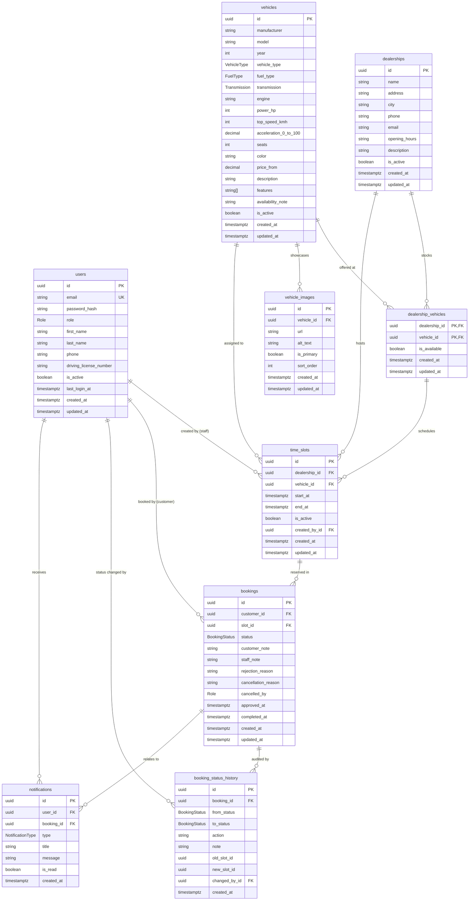

# Entity-Relationship Diagram (ERD)

This document visualizes the relational database architecture for the **Luxury Car Test-Drive Booking and Management System** implemented in PostgreSQL via Prisma ORM.

## Database Constraints & Integrity Rules

1. **Slot Time Order Check**:
   `CONSTRAINT time_slots_end_after_start CHECK (end_at > start_at)`
2. **Vehicle Non-Overlapping Slot Integrity**:
   `CONSTRAINT time_slots_no_overlap EXCLUDE USING gist (vehicle_id WITH =, tstzrange(start_at, end_at) WITH &&) WHERE (is_active)`
   *Powered by PostgreSQL `btree_gist` extension.*
3. **One Active Booking Per Slot**:
   `CREATE UNIQUE INDEX one_active_booking_per_slot ON bookings (slot_id) WHERE status IN ('PENDING', 'APPROVED', 'RESCHEDULED');`
4. **Referential Integrity**:
   - `dealership_vehicles` and `vehicle_images` cascade on delete of `dealerships` / `vehicles`.
   - `booking_status_history` cascades on delete of `bookings`.
   - `notifications` cascades on delete of `users`, and sets `booking_id` null if booking is removed.

