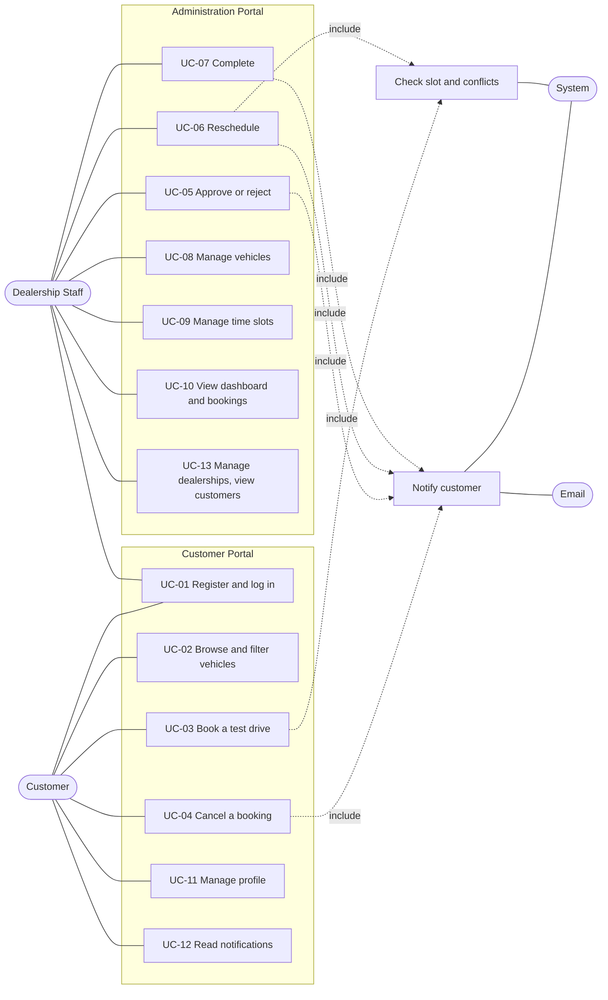

# Use cases

Actors, a use-case diagram and fully dressed use cases for the Luxury Car Test-Drive Booking and Management System. Business rules (A1 to A11) and requirement identifiers refer to `docs/srs-draft.md`.

## 1. Actors

| Actor | Type | Description |
| --- | --- | --- |
| Customer | Primary | A registered user who browses vehicles and books test drives. A visitor (not signed in) can browse and register. |
| Dealership Staff | Primary | An authenticated employee who manages the catalogue, slots and bookings. |
| System | Secondary | The application: enforces rules, writes history, creates notifications. |
| Email | Secondary | The SMTP transport that delivers notification e-mails. Optional; failures are ignored by the business flow. |

## 2. Use case list

| ID | Use case | Primary actor | Requirements |
| --- | --- | --- | --- |
| UC-01 | Register and log in | Customer, Staff | FR-1 |
| UC-02 | Browse and filter vehicles | Customer (or visitor) | FR-4, FR-5.5 |
| UC-03 | Book a test drive | Customer | FR-6 |
| UC-04 | Cancel a booking | Customer | FR-8 |
| UC-05 | Approve or reject a booking | Staff | FR-7.1, FR-7.2, FR-9 |
| UC-06 | Reschedule a booking | Staff | FR-7.3 |
| UC-07 | Complete a booking | Staff | FR-7.5 |
| UC-08 | Manage vehicles | Staff | FR-3 |
| UC-09 | Manage time slots | Staff | FR-5 |
| UC-10 | View the dashboard and bookings | Staff | FR-9 |
| UC-11 | Manage profile | Customer | FR-2 |
| UC-12 | Read notifications | Customer | FR-9.4, FR-9.5 |
| UC-13 | Manage dealerships and view customers | Staff | FR-3.5, FR-3.6, FR-9.6 |

UC-11 to UC-13 are listed for completeness; UC-01 to UC-10 are described in full below.

## 3. Use case diagram

## 4. Fully dressed use cases

### UC-01 Register and log in

| Item | Description |
| --- | --- |
| Primary actor | Customer (registration and login); Staff (login only) |
| Goal | Obtain an authenticated session. |
| Preconditions | The user has a browser. For login, an active account exists. |
| Trigger | The user opens the registration page, the login page or the administration login page. |
| Postconditions (success) | A session cookie is set; the user is taken to the page they asked for or to the home or dashboard page. |
| Postconditions (failure) | No session is created; no account data is revealed. |

**Main flow (register)**

1. The customer opens `/register` and enters name, e-mail, phone, optional driving licence number and password.
2. The web form validates the fields and sends them to the API.
3. The System validates the input again, checks that the e-mail is unused, hashes the password (bcrypt, cost 12) and stores a CUSTOMER account.
4. The System signs the customer in and the portal shows the home page.

**Main flow (login)**

1. The user enters e-mail and password on `/login` (customers) or `/admin/login` (staff).
2. The System finds the account, compares the password hash and checks that the account is active.
3. The System issues a JWT in an httpOnly cookie and returns the user.
4. The portal redirects to the originally requested page, or to the home page (customer) or dashboard (staff).

**Alternative and exception flows**

- 3a. The e-mail already exists: the form shows "an account with this e-mail already exists" (`EMAIL_TAKEN`).
- 3b. Validation fails (for example password without a number): messages appear next to the fields (`VALIDATION_ERROR`).
- L2a. Unknown e-mail or wrong password: the same "invalid email or password" message (`INVALID_CREDENTIALS`).
- L2b. The account is deactivated and the password is right: `ACCOUNT_DISABLED`.
- L2c. Five failures for an e-mail: the System answers 429 with a wait time and the form shows the error message returned by the System.
- L4a. A customer signs in on the administration page: the customer session cannot open `/admin` and sees the access-denied page.

### UC-02 Browse and filter vehicles

| Item | Description |
| --- | --- |
| Primary actor | Customer or visitor |
| Goal | Find a vehicle of interest and see its details. |
| Preconditions | None. |
| Trigger | The user opens `/vehicles`. |
| Postconditions | The user sees matching active vehicles; nothing is changed. |

**Main flow**

1. The portal shows the first page of active vehicles.
2. The user types a search text and/or selects manufacturer, model, vehicle type and fuel type.
3. The System returns the matching active vehicles with pagination; the address bar reflects the filters.
4. The user opens a vehicle card.
5. The portal shows images, specifications, features, dealership availability and a "Book a test drive" action.

**Alternative flows**

- 3a. No vehicle matches: an empty state offers to clear the filters.
- 5a. The vehicle was deactivated in the meantime: a "not found" page is shown.

### UC-03 Book a test drive

| Item | Description |
| --- | --- |
| Primary actor | Customer |
| Goal | Reserve one slot for a vehicle at a dealership. |
| Preconditions | The customer is signed in; the vehicle has at least one available slot. |
| Trigger | The customer chooses "Book a test drive" on a vehicle or slot. |
| Postconditions (success) | A PENDING booking occupies the slot; a history row exists; the customer sees a confirmation and the booking appears in "My bookings". |
| Postconditions (failure) | No booking is created and the slot is unchanged. |

**Main flow**

1. The customer selects the vehicle, a dealership offering it, a date and an available time slot (shown in local time).
2. The customer optionally adds notes and confirms.
3. The System validates the request and, in one transaction, locks the slot, the vehicle's offer at the dealership and the customer, and re-checks that the slot is active, in the future and free (A4, A5).
4. The System checks that the customer has no overlapping active booking and fewer than 3 active bookings.
5. The System creates the booking in status PENDING and writes the first history row.
6. The portal shows the confirmation with the booking reference and the time.

**Alternative and exception flows**

- 3a. Another customer booked the slot first: 409 `SLOT_UNAVAILABLE`; the portal explains this and refreshes the available slots.
- 3b. The slot has started: 422 `SLOT_IN_PAST`.
- 4a. The customer already has a booking at an overlapping time: 409 `BOOKING_CONFLICT`.
- 4b. The customer already has 3 active bookings: 409 `ACTIVE_BOOKING_LIMIT`.
- 1a. The customer is not signed in: the portal redirects to login and returns to the booking afterwards.
- 1b. A staff account tries to book: 403 `FORBIDDEN`.

### UC-04 Cancel a booking

| Item | Description |
| --- | --- |
| Primary actor | Customer |
| Goal | Release a booking the customer can no longer attend. |
| Preconditions | The customer owns a PENDING, APPROVED or RESCHEDULED booking. |
| Trigger | The customer chooses "Cancel booking" in "My bookings" or on the booking page. |
| Postconditions (success) | Status CANCELLED, slot released, history row and notification written. |
| Postconditions (failure) | The booking is unchanged. |

**Main flow**

1. The customer opens the booking; the portal states the cancellation rule and offers the action when the slot starts at least 24 hours from now; otherwise it shows a message explaining why not.
2. The customer confirms in the dialog.
3. The System locks the booking, checks ownership and status, and checks the 24-hour window (A3).
4. The System sets CANCELLED, writes the history row (actor: customer) and a notification, and commits.
5. The portal moves the booking to "Cancelled" and the slot becomes available again; the System attempts an e-mail after the commit.

**Alternative flows**

- 3a. Less than 24 hours remain: 409 `CANCELLATION_WINDOW_PASSED`; the booking page shows the rule instead of the cancel button, and the customer contacts the dealership.
- 3b. The booking is no longer active (for example staff already cancelled it): 409 `INVALID_STATUS_TRANSITION`.
- 3c. The booking belongs to someone else or does not exist: 404 `NOT_FOUND`.
- 5a. The e-mail cannot be sent: the failure is logged; the cancellation stands.

### UC-05 Approve or reject a booking

| Item | Description |
| --- | --- |
| Primary actor | Dealership Staff |
| Goal | Decide a pending request. |
| Preconditions | Staff are signed in; the booking is PENDING. |
| Trigger | Staff open a booking from the dashboard or the bookings list. |
| Postconditions (success) | Status APPROVED or REJECTED; history row and customer notification written; a rejected booking releases its slot. |

**Main flow (approve)**

1. Staff open the booking; the page enables only the actions valid for PENDING; the others are disabled and say why.
2. Staff choose "Approve" and confirm.
3. The System locks the booking, checks that the transition PENDING to APPROVED is allowed (A2) and sets the status.
4. The System writes the history row (actor: staff) and the in-app notification in the same transaction.
5. After the commit the System attempts the e-mail; the page shows the new status immediately.

**Main flow (reject)**

1. Staff choose "Reject" and enter a reason (required).
2. Steps 3 to 5 as above with PENDING to REJECTED; the slot becomes available.

**Alternative flows**

- 2a. The reason is missing: 422 and a message at the field.
- 3a. Another staff member decided the booking first: 409 `INVALID_STATUS_TRANSITION`; the page refreshes and shows the current status.
- 5a. E-mail failure: ignored for the business result.

### UC-06 Reschedule a booking

| Item | Description |
| --- | --- |
| Primary actor | Dealership Staff |
| Goal | Move a booking to another slot of the same vehicle. |
| Preconditions | The booking is PENDING, APPROVED or RESCHEDULED; another available slot exists for the vehicle. |
| Trigger | Staff choose "Reschedule" on the booking. |
| Postconditions (success) | The booking points to the new slot; status RESCHEDULED; the old slot is free; history records old and new slot; the customer is notified. |

**Main flow**

1. Staff choose "Reschedule"; the page lists available slots of the same vehicle (any dealership offering it), in local time.
2. Staff select a slot and add an optional note.
3. The System locks both slots and the booking, checks that the new slot is available and that the customer has no overlapping active booking (A5, A7).
4. The System moves the booking, sets RESCHEDULED, writes history (old slot, new slot) and the notification.
5. The page shows the new time; the e-mail is attempted after the commit.

**Alternative flows**

- 3a. The chosen slot was taken meanwhile: 409 `SLOT_UNAVAILABLE`.
- 3b. The new time overlaps another booking of the customer: 409 `BOOKING_CONFLICT`.
- 3c. The new slot is in the past: 422 `SLOT_IN_PAST`.
- 3d. The booking is final (rejected, cancelled, completed): 409 `INVALID_STATUS_TRANSITION`.

### UC-07 Complete a booking

| Item | Description |
| --- | --- |
| Primary actor | Dealership Staff |
| Goal | Record that the test drive took place. |
| Preconditions | The booking is APPROVED or RESCHEDULED and its slot start is in the past. |
| Trigger | Staff choose "Complete". |
| Postconditions (success) | Status COMPLETED (final); history row and notification written. |

**Main flow**

1. Staff open the booking; "Complete" is enabled once the slot start has passed.
2. Staff confirm, optionally with a note.
3. The System locks the booking, checks the transition and that the slot start is in the past (A2), sets COMPLETED, writes history and the notification.
4. The booking appears under "Completed" for the customer.

**Alternative flows**

- 3a. The slot has not started yet: 409 `INVALID_STATUS_TRANSITION`; the page explains that completion is possible after the start time (the action is disabled until then).
- 3b. The booking is PENDING (never approved): the action is disabled with an explanation; the API answers 409.

### UC-08 Manage vehicles

| Item | Description |
| --- | --- |
| Primary actor | Dealership Staff |
| Goal | Keep the vehicle catalogue accurate. |
| Preconditions | Staff are signed in. |
| Trigger | Staff open `/admin/vehicles`. |
| Postconditions | Vehicle records, images and dealership availability reflect the change. |

**Main flow (add)**

1. Staff choose "New vehicle" and enter specifications, features, description and availability note.
2. The System validates and creates the vehicle; the staff list shows it as active.
3. Staff upload images (JPEG, PNG, WebP; 5 MB each), mark one as primary and set alt text and order.
4. Staff select the dealerships that offer the vehicle.

**Alternative flows**

- E1. Edit: staff open a vehicle, change fields and save.
- D1. Deactivate: staff choose "Deactivate"; if no future active bookings exist the vehicle is hidden from customers and kept for history. Reactivation is possible at any time.
- D2. Future active bookings exist: 409 `HAS_ACTIVE_BOOKINGS`; the message tells staff to cancel or reschedule them first.
- U1. An invalid image (wrong type, over 5 MB): 422 `UPLOAD_INVALID`.
- W1. Withdrawing the vehicle from a dealership that has future active bookings for it: 409 `HAS_ACTIVE_BOOKINGS`.

### UC-09 Manage time slots

| Item | Description |
| --- | --- |
| Primary actor | Dealership Staff |
| Goal | Publish and maintain bookable windows. |
| Preconditions | The vehicle exists and is offered at the dealership. |
| Trigger | Staff open `/admin/slots`. |
| Postconditions | Slots exist without overlaps; customers see only available future slots. |

**Main flow (single slot)**

1. Staff choose "New slot", select dealership and vehicle and enter start and end times.
2. The System validates (end after start, not in the past), checks overlap with other slots of the vehicle and creates the slot.

**Main flow (bulk)**

1. Staff choose "Bulk create" and enter date range (up to 92 days), weekdays, daily window, slot length and break.
2. The page asks the System for a preview (dry run) that lists the slots to create and those skipped because they would overlap.
3. Staff confirm; the System creates the slots in one transaction.

**Alternative flows**

- 2a. The slot overlaps an existing slot of the vehicle: 409 `SLOT_OVERLAP` (also guaranteed by the database exclusion constraint).
- 2b. The start is in the past: 422 `SLOT_IN_PAST`.
- E1. Edit times: allowed only while the slot has no active booking; otherwise 409 `HAS_ACTIVE_BOOKINGS`.
- D1. Deactivate: allowed only while there is no future active booking, otherwise 409 `HAS_ACTIVE_BOOKINGS`.

### UC-10 View the dashboard and bookings

| Item | Description |
| --- | --- |
| Primary actor | Dealership Staff |
| Goal | See the state of all test-drive activity and find a booking. |
| Preconditions | Staff are signed in. |
| Trigger | Staff open `/admin` or `/admin/bookings`. |
| Postconditions | None (read only). |

**Main flow**

1. The dashboard shows eight summary cards (for example awaiting decision, today's test drives, next 7 days, completed and cancelled this month, free slots), each linking to the matching filtered list, a booking trend for a chosen number of days and the most booked vehicles.
2. Staff open "Bookings" and filter by status, dealership, vehicle, customer text and date range, and sort the list.
3. The System returns the matching bookings with pagination; the filters are kept in the address.
4. Staff open a booking to see its details, the customer and the status timeline, and to act on it (UC-05 to UC-07).

**Alternative flows**

- 3a. No booking matches: an empty state offers to reset the filters.
- 1a. A customer opens `/admin`: access denied (403 page); the dashboard endpoints answer 403.
